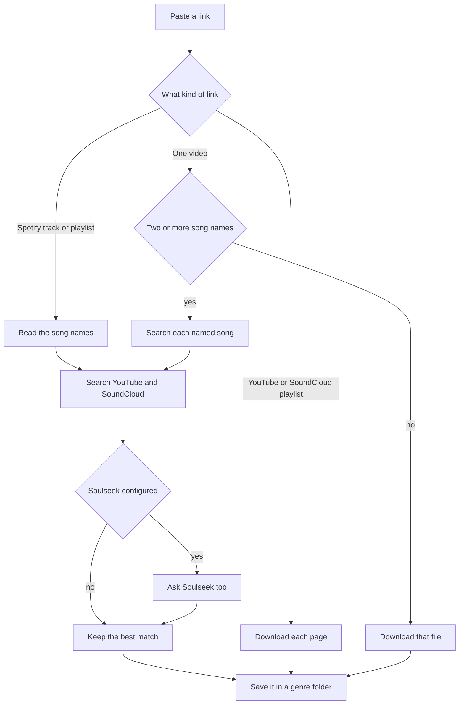

# djgrab

get downloads from any streaming platform, for free

```text
~/djgrab/{genre}/{artist} - {title}.m4a
```

You are responsible for what you download.

## Install

```bash
uv sync
uv run djgrab doctor
```

`doctor` checks that `yt-dlp` and `ffmpeg` are installed. Quote URLs in zsh.

```bash
uv run djgrab "https://www.youtube.com/watch?v=..."
```

Songs go to `~/djgrab/`. The database stays in `~/.djgrab/`.

## Commands

```bash
djgrab doctor
djgrab "https://www.youtube.com/watch?v=..."
djgrab "https://soundcloud.com/artist/track"
djgrab "https://soundcloud.com/artist/sets/..."
djgrab "https://open.spotify.com/track/..."
djgrab "https://open.spotify.com/playlist/..."
djgrab clear
```

`clear` deletes the database. The audio files stay.

## How a link is handled



- A YouTube or SoundCloud page is downloaded from that URL.
- A playlist downloads each page. One failure does not stop the rest.
- A Spotify link is only a name. The audio is searched for elsewhere.
- A video that names two or more songs is a DJ set. Each song is searched and downloaded. The mix is not saved.
- Names come from chapters, then the description, then a comment.
- The same artist, title, and mix is not downloaded again.

## Search

Usable results contain every title word and every artist word. A known length must be within 15 seconds.

1. Lossless Soulseek file (flac, wav, aiff)
2. Closest length
3. Fewer extra title words
4. Uploader matches the artist

A locked or missing file is skipped. A Soulseek peer that sends nothing is skipped after 15 seconds. Nothing usable ends as `buylist`.

YouTube and SoundCloud files are m4a and marked lossy. The cover is embedded when the site has one. Genre comes from an iTunes artist search. No match uses `Unknown`.

## Configure

Optional. YouTube and SoundCloud need no account.

Soulseek is off until both fields are set:

```bash
djgrab config soulseek.username your-soulseek-username
djgrab config soulseek.password your-soulseek-password
```

That writes `~/.djgrab/djgrab.toml`. Any `section.key` works the same way, for example `djgrab config spotify.client_id ...`. Or save this file yourself:

```toml
[download]
sources = ["youtube", "soundcloud"]
format = "m4a"
bitrate = "256k"

[library]
fallback_genre = "Unknown"

[soulseek]
username = "your-soulseek-username"
password = "your-soulseek-password"
```

A `djgrab.toml` in the current directory is used first.

## What it cannot do (yet)

- Download directly from Spotify or SoundCloud Go+ audio
- Listen to a mix and name the songs
- Cut a DJ mix into separate files
- Play a song, buy it, or sync a DJ app

## Tests

```bash
uv sync --extra dev
uv run pytest
```
