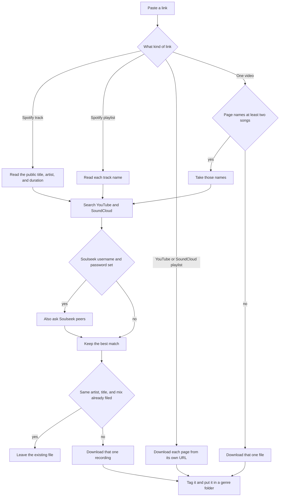

# djgrab

djgrab keeps a copy of a song you already know you want. You paste a link. It saves one audio file per song:

```text
~/djgrab/{genre}/{artist} - {title}.m4a
```

A YouTube or SoundCloud link that is the recording itself is downloaded from that page. A Spotify link is only a name, because Spotify audio is locked, so djgrab searches for the same song elsewhere. A DJ set is one long video: djgrab reads the song names and downloads each song on its own. The mix is not saved and is not sliced apart.

You are responsible for what you download. djgrab does not unlock Spotify or SoundCloud Go+.

## How a link is handled



A playlist failure skips that entry and continues. A set does the same for each named song. Downloads run one song at a time. The searches for one song run together.

Song names inside a video are read in this order: YouTube chapters, timestamp lines in the description (`12:34 Artist - Title`), plain `Artist - Title` lines, then the first comment that lists at least two timestamps. Notes in brackets, such as `[ Unreleased ]`, are dropped. The time a song plays inside the mix is not stored as its length, because a DJ does not play the studio recording for the same number of seconds.

## How a search picks a file

The query is the artist and title. These words are removed before the search: remaster, remastered, official, audio, video, lyric, lyrics, hd, hq, and a 4-digit year. Accents are ignored while comparing. The saved filename keeps the original spelling.

A result is usable when every title word appears in its title and every artist word appears in its artist. If the track has a length, the result must be within 15 seconds. A song taken from a DJ set has no length, so that check is skipped. If the track has a mix, the result's trailing parenthetical must be that mix. An artist stored as `Unknown` has to match the title exactly, so `Luna` does not grab a longer filename that merely contains that word.

When several results pass, they are ordered like this:

1. A lossless Soulseek file (flac, wav, or aiff) beats a lossy file.
2. Closest length, when the track has a length.
3. Fewer extra words in the title.
4. An uploader whose name matches the artist.

DRM, unavailable, and private errors drop that file and try the next one. A Soulseek user who accepts the request and then sends nothing is skipped after 15 seconds, and the next result is tried. No usable file ends as `buylist`.

YouTube and SoundCloud files are AAC in m4a at 256 kbps and are marked lossy. A matching Soulseek flac, wav, or aiff is marked lossless. The picture from YouTube or SoundCloud is embedded when the site provides one. A missing picture does not stop the download. A Soulseek file keeps the cover it already had.

The genre folder comes from an iTunes artist search: the artist whose name matches, otherwise the first result. `A feat. B` searches the full credit, then the first name. `library.genres` can rename a genre (`"dance pop" = "Pop"`). Anything else uses the genre text. No match uses `Unknown`.

A file that is already stored with the same artist, title, and mix is not downloaded again. A different mix is a different song. If you delete the file from disk, the next link downloads it again.

## Install

On a Mac, Homebrew installs uv, yt-dlp, and ffmpeg. uv installs the `djgrab` command:

```bash
brew install uv yt-dlp ffmpeg
uv tool install git+https://github.com/saarazari5/djgrab
djgrab doctor
djgrab "https://www.youtube.com/watch?v=..."
```

`doctor` exits with an error when `yt-dlp` or `ffmpeg` is missing. Quote the URL in zsh so `?` is not treated as a pattern.

Songs are saved in `~/djgrab/`. The database and temporary files are in `~/.djgrab/`. `--data somewhere` stores the database in `somewhere/` and the songs in `somewhere/djgrab/`. `DJGRAB_DATA` does the same.

```bash
uv tool upgrade djgrab
```

On Linux, install `ffmpeg` with your package manager and install [uv](https://docs.astral.sh/uv/getting-started/installation/) and `yt-dlp`, then run the same `uv tool install` line.

### Windows

Install Ubuntu from the Microsoft Store and open its terminal. Homebrew there is the Linux build, which is how a formula runs on Windows. In that terminal:

```bash
/bin/bash -c "$(curl -fsSL https://raw.githubusercontent.com/Homebrew/install/HEAD/install.sh)"
eval "$(/home/linuxbrew/.linuxbrew/bin/brew shellenv)"
brew tap saarazari5/djgrab https://github.com/saarazari5/djgrab
brew trust saarazari5/djgrab
brew install --HEAD saarazari5/djgrab/djgrab
djgrab doctor
```

Add the `eval` line to `~/.bashrc` so new terminals find `brew` and `djgrab`. Songs are saved in the Linux home folder, `~/djgrab/`, which is inside the WSL filesystem.

To work on the code:

```bash
uv sync --extra dev
uv run pytest
uv run djgrab doctor
```

## Commands

```bash
djgrab doctor
djgrab "https://www.youtube.com/watch?v=..."
djgrab "https://soundcloud.com/artist/track"
djgrab "https://soundcloud.com/artist/sets/..."
djgrab "https://open.spotify.com/track/..."
djgrab "https://open.spotify.com/playlist/..."
djgrab clear
```

`--config` and `--data` can go before or after the link. A word that is not `doctor`, `clear`, or a URL is refused.

`djgrab clear` deletes `~/.djgrab/djgrab.sqlite`. The audio files stay. After a clear, djgrab no longer knows which songs were already downloaded, so the next link fetches them again.

The last line of a download is `status: message`. Exit code 1 means that download failed. Exit code 2 means the link was refused.

## Configure

You can skip this. With no config file, YouTube and SoundCloud are searched and songs go to `~/djgrab/`.

Soulseek is optional. It asks other people on the Soulseek network for a file of that song and prefers a lossless copy. Create the account in the Soulseek app first, then save this as `~/.djgrab/djgrab.toml`:

```toml
[download]
enabled = true
sources = ["youtube", "soundcloud"]
format = "m4a"
bitrate = "256k"

[library]
fallback_genre = "Unknown"

[library.genres]
pop = "Pop"
"dance pop" = "Pop"

[spotify]
client_id = ""
client_secret = ""

[soulseek]
username = "your-soulseek-username"
password = "your-soulseek-password"
```

Leave `username` and `password` empty to keep Soulseek off. Both must be set for it to run. One login is reused until the command exits.

Spotify keys are optional. The genre folder does not need them. `SPOTIFY_CLIENT_ID` and `SPOTIFY_CLIENT_SECRET` override the file when they are set.

A `djgrab.toml` in the current directory is used first. `--config /path/to/djgrab.toml` picks a file directly.

| Key | Meaning |
| --- | --- |
| `sources` | `youtube` and `soundcloud` |
| `format` | `m4a` or `mp3` |
| `bitrate` | audio bitrate, default `256k` |
| `fallback_genre` | folder used when no genre is found |
| `genres` | map a genre string to a folder name, ignoring case |

## Tests

```bash
uv sync --extra dev
uv run pytest
```

Tests are offline except one that serves a wav on localhost and runs `yt-dlp` and `ffmpeg`.

## What it cannot do

- It cannot download the audio from Spotify or from SoundCloud Go+. Those files stay locked. A Spotify link is used only for the public title, artist, and duration.
- It cannot hear a mix and name the songs. A DJ mix overlaps tracks, so silence detection and fingerprinting pick the wrong recording. If the page does not name at least two songs, the video is saved as one file.
- It cannot cut that video into separate songs. Named songs are searched and downloaded as their own recordings.
- It cannot play the file, buy it from a store, or sync Rekordbox or another DJ app.
- It cannot invent a genre. If iTunes has no matching artist, the file goes in `Unknown`.
- It cannot tell two different recordings apart when they share the same artist, title, and mix. The second link keeps the file already on disk.
